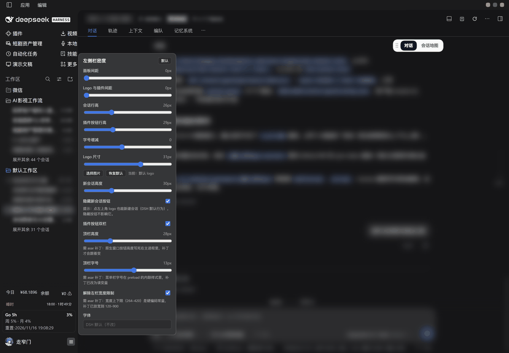
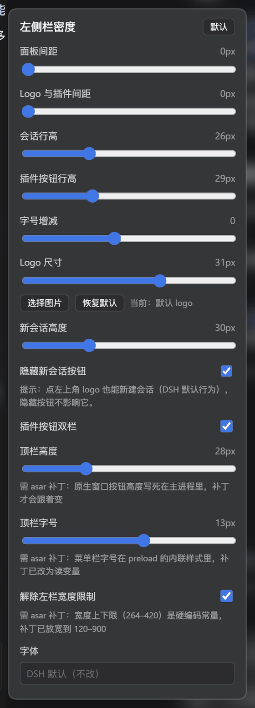
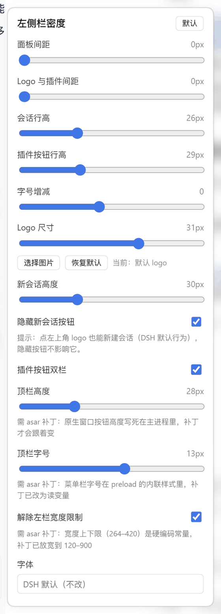

# 左侧栏密度（dsh-sidebar-density）

把 DeepSeek Harness 左侧栏的行高、间距、字号、Logo 尺寸、新会话按钮高度搬进一个浮层，拖动滑块即时生效；「应用 / 编辑」标题栏的高度与字号、以及左栏宽度上下限，也能在同一个浮层里调（这三项需要给 `app.asar` 打配套补丁，见下）。



## 它解决什么

DSH 左侧栏的几何是写死的：会话行固定高度、内边距固定、Logo 固定、插件按钮固定两行。屏幕小的时候一屏装不下几个会话，屏幕大的时候又空得厉害；想换字体、想让 Logo 大一点，都没有入口。

这个插件把这些数字变成滑块，改的是左侧栏自己的 CSS 变量与几何，不碰任何业务逻辑。

## 怎么打开

鼠标移到左侧栏底部账号按钮那一行，点最右边的「密度」图标（三横线），浮层贴着左栏右边缘向上展开。

- 拖动即生效，没有「保存」按钮；
- 点浮层外面收起；
- 右上角「默认」一键回到出厂值（只重置配置，不卸载插件）。

| 暗色 | 亮色 |
| --- | --- |
|  |  |

## 能调什么

| 控件 | 默认 | 范围 | 改的是什么 |
| --- | --- | --- | --- |
| 面板间距 | 1px | 0–12 | 侧栏里插件按钮之间的竖直间距 |
| Logo 与插件间距 | 4px | 0–40 | 品牌 Logo 行与下方插件区之间留多少空 |
| 会话行高 | 26px | 20–40 | 会话列表每一行的高度（原本写死 32px） |
| 插件按钮行高 | 29px | 22–44 | 插件区每个按钮的高度 |
| 字号增减 | 0 | −3 ~ +4 | 在各自原始字号上做偏移，不是绝对值 |
| Logo 尺寸 | 24px | 14–40 | 品牌 Logo 的宽高；也可以「选择图片」换成自己的 logo |
| 新会话高度 | 30px | 24–44 | 顶部「新会话」按钮的高度 |
| 隐藏新会话按钮 | 关 | 开关 | 隐藏后仍可点左上角 logo 新建会话（DSH 默认行为） |
| 插件按钮双栏 | 关 | 开关 | 插件区改两列排布，条目多时省一半竖向空间；列宽按每一项的文字实测宽度自动取 |
| 双栏列间距 | 8px | 0–24 | 两列之间的额外空档 |
| 顶栏高度 | 28px | 20–48 | 「应用 / 编辑」标题栏高度，**需 asar 补丁** |
| 顶栏字号 | 12px | 9–16 | 标题栏菜单文字字号，**需 asar 补丁** |
| 解除左栏宽度限制 | 开 | 开关 | 左栏宽度上下限从 264–420 放宽到 120–900，**需 asar 补丁** |
| 字体 | DSH 默认 | 系统字体搜索 | 只作用于左侧栏文字，可选预设或搜索本机字体 |

配置存在 `localStorage` 的 `dsh-sidebar-density:settings`，跨会话保留、跟着 profile 走。

## 三个需要 asar 补丁的项

DSH 把这几处写死在 `app.asar` 里，插件层改不到，所以浮层里这三项下方都标了「需 asar 补丁」。配套补丁脚本是 `dsh-enhance-tools/tools/patch-density.cjs`（等长字面量替换 + 原地改 integrity hash，改完过 `node --check`）。

| 项 | 打补丁前 | 打补丁后 |
| --- | --- | --- |
| 标题栏高度 | `titleBarOverlay.height = 40`，preload 里写死 `40px` 内联变量 | 24px 起可调；`frame: false` + 自绘按钮，顶栏才能继续缩 |
| 标题栏字号 | preload 内联样式里直接写死像素 | 改读 `--dsh-caption-font` 变量，滑块才跟得上 |
| 左栏宽度 | `SIDEBAR_MIN = 264`、`SIDEBAR_MAX = 420`、`clampWidth(…,264,420)` | `120` / `900`，`sidebar` 默认从 280 收到 220 |

不打补丁时：这三项拖了也不报错，只是不生效——原生窗口按钮高度和宽度上限仍然按 DSH 的原值走。补丁只改你自己那份安装的 `app.asar`，升级 DSH 后要重打。

> 20px 是原生按钮的安全下限，再小会被裁掉像素；补丁默认 24px。

## 它改的是什么

只覆盖左侧栏自己的变量与几何：

- `--dsh-sidebar-inline-padding` / `--dsh-sidebar-row-padding` / `--dsh-sidebar-label-gap`；
- `[role="treeitem"]` 的写死高度（会话行与工作区行）；
- 插件区 `nav[aria-label]` 的行高与列数；
- 品牌行 logo 尺寸、新会话按钮高度、`--dsh-caption-*` 三个顶栏变量。

选择器只用结构与语义钩子（`data-sidebar-scrollport`、`role="treeitem"`、`nav[aria-label]`、`#dsh-sidebar-density-*`），不写构建产物里带哈希的类名——那些跨版本必变。浮层配色全部取自宿主主题令牌（`--dsw-*`），亮暗都跟。

## 安装

```sh
# 从仓库装
dsh plugin add pcysanji/dsh-sidebar-density

# 或从 npm
dsh plugin add dsh-sidebar-density
```

装完重启 DSH；宿主侧只多一个字体枚举路由（`/sidebar-density/fonts`），其余全在客户端。

## 边界

- 窗口宽度低于 1024px 时，官方布局会把左栏整体收成 56px 图标栏，这段不由本插件接管。
- 右侧面板宽度、会话语义、任何功能开关都不改。
- 会话正文的字号不在这里（设置 → 通用设置 → 字号大小）。
- 三个 asar 项依赖补丁；DSH 大版本升级后补丁会失效，需要重打。
- 双栏列宽是按每一项的文字实测宽度算的；侧栏窄到两列加起来放不下时，只会让最长的那个走省略号，其余不受影响。

## English

Sidebar density controls for DeepSeek Harness. A small popover next to the account button in the sidebar footer exposes sliders for session row height, plugin row height and spacing, logo size, font size delta, new-session button height, a double-column plugin layout, and an optional custom logo. Changes apply while you drag and persist in `localStorage`.

Three controls — window caption height, caption font size, and the sidebar width clamp — live inside `app.asar` and only take effect with the companion patch (`patch-density.cjs`), which rewrites those constants and the integrity hashes in place. The popover labels them as patched items; without the patch they simply do nothing.

Only the sidebar's own CSS variables and geometry are touched. Nothing about sending, sessions, or model behaviour changes.

## License

MIT
